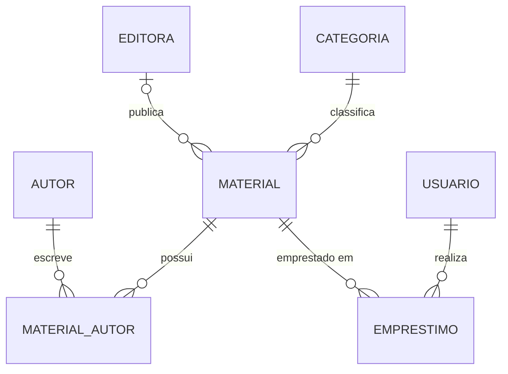

# Requisitos e modelagem

Versão em Markdown do planejamento. Fonte: [NP2 – Biblioteca Virtual Planejamento Completo.pdf](NP2%20%E2%80%93%20Biblioteca%20Virtual%20Planejamento%20Completo.pdf).

A NP2 é o backend (API REST) de uma biblioteca pública virtual para uma escola de ensino
médio, feito em equipe de 3 pessoas, com entrega até 08/11/2026 (prazo estendido; o original era 06/11). Não há
interface visual.

## O que o professor exige

- 5 CRUDs completos (cadastrar, editar, listar, consultar por ID, excluir); o CRUD de usuário das aulas não conta
- Pelo menos 1 funcionalidade extra, alinhada com o professor
- Entidades com 4+ atributos além do ID e relacionamentos coerentes
- Camadas Model, DTO, Repository, Service e Controller
- Persistência em banco com migrations
- Validação de dados e tratamento de erros com códigos HTTP adequados
- Todas as rotas documentadas no Swagger
- GitHub com instruções de execução e contribuições de todos
- Uso de IA permitido, mas precisa ser registrado (ferramenta, uso e verificação)

### Avaliação (10 pontos)

| Bloco | Critério | Pontos |
|---|---|---|
| Sistema (equipe) | Funcionamento dos 5 CRUDs | 1,0 |
| Sistema (equipe) | Funcionalidade extra | 1,0 |
| Sistema (equipe) | Modelagem e camadas | 0,5 |
| Sistema (equipe) | Persistência e migrations | 0,5 |
| Sistema (equipe) | Validações e erros | 0,5 |
| Sistema (equipe) | Swagger e instruções | 0,5 |
| Apresentação (individual) | Clareza sobre a própria participação | 1,0 |
| Apresentação (individual) | Compreensão do código e decisões | 1,0 |
| Apresentação (individual) | Respostas às perguntas | 1,0 |
| GitHub (individual) | Contribuições relevantes | 1,0 |
| GitHub (individual) | Participação ao longo do projeto | 1,0 |
| GitHub (individual) | Commits identificáveis e descritivos | 1,0 |

A apresentação tem até 15 minutos: 10 de demo e 5 de perguntas individuais, sem IA e sem
responder pelo colega.

## Stack

| Requisito | Ferramenta |
|---|---|
| Linguagem / framework | Java com Spring Boot |
| Repository | Spring Data JPA |
| Migrations | Flyway |
| Validação | Bean Validation (`@Valid`, `@NotBlank` etc.) |
| Tratamento de erros | `@RestControllerAdvice` (`GlobalExceptionHandler`) |
| Swagger | springdoc-openapi |
| Tarefas agendadas | `@Scheduled` (status de atraso) |

## Decisões já tomadas

- **Banco de dados:** MySQL 8.4, rodando via Docker (`docker-compose.yml`). No PDF estava
  "a definir (PostgreSQL, MySQL ou H2)".
- **Schema:** criado e alterado só por migrations do Flyway; o Hibernate roda com
  `ddl-auto=validate` (apenas confere se as entidades batem com o banco).
- **Categoria:** `serieRecomendada` é obrigatória, porque no planejamento os campos
  opcionais estão marcados explicitamente como "opcional" e este não está.
- **Material:** pelo mesmo critério, `anoPublicacao` e `quantidadeLicencas` são obrigatórios
  (`NOT NULL`). A tabela foi criada na `V21` só com a ligação a Categoria; `editora_id` e a
  tabela `material_autor` entraram na `V22`, depois que as tabelas `editoras` e `autores`
  (Pessoa 1) chegaram na `main`.
- **Material – autores:** "um ou mais autores" (RF02), então `autoresIds` não pode ser vazio. IDs repetidos
  na lista são ignorados, e um ID que não existe devolve 404 dizendo qual faltou.
- **Material – ano:** "até o ano atual" é checado pela anotação própria `@AnoNaoFuturo`, porque o `@Max`
  só aceita um número fixo.
- **RN06:** o Service checa antes de excluir e devolve 409 com a mensagem da regra. Como rede de segurança,
  qualquer recusa do banco por constraint (`DataIntegrityViolationException`) também vira 409.
- **Autor e Editora:** `dataNascimento` (autor) e `site` (editora) são opcionais, porque nem sempre se
  sabe a data de nascimento do autor e nem toda editora tem site.
- **CNPJ:** validado com `@CNPJ` (confere os dígitos verificadores) e salvo só com os 14 dígitos, para
  `11.222.333/0001-81` e `11222333000181` contarem como o mesmo na regra de CNPJ único.
- **Funcionalidade extra:** a fila de espera foi substituída pela recomendação personalizada (o plano B do
  planejamento), porque a fila dependia de Usuário e Empréstimo, que só ficaram prontos no fim.

**Em aberto:**
- Valor de RN02 (prazo padrão de empréstimo; sugestão: 14 dias)
- Valor de RN04 (máximo de empréstimos ativos por usuário; sugestão: 3)
- Dias dos acompanhamentos semanais com o professor

## Entidades

Os 5 CRUDs são **Material, Autor, Editora, Categoria e Emprestimo** (opção B, biblioteca
clássica). A funcionalidade extra é a **recomendação personalizada**, que não cria entidade
nova, e o **Usuário** das aulas é reaproveitado sem contar como CRUD.

### Nomes e convenções

| Classe Java | Tabela | Rota |
|---|---|---|
| `Material` | `materiais` | `/materiais` |
| `Autor` | `autores` | `/autores` |
| `Editora` | `editoras` | `/editoras` |
| `Categoria` | `categorias` | `/categorias` |
| `Emprestimo` | `emprestimos` | `/emprestimos` |
| `Usuario` | `usuarios` | `/usuarios` |
| `Avaliacao` | `avaliacoes` | `/avaliacoes` |
| `ProgressoLeitura` | `progressos_leitura` | `/emprestimos/{id}/progresso` |
| (ligação N:N) | `material_autor` | — |

- Classes no singular, PascalCase e sem acento
- Tabelas no plural e em snake_case (`@Table`)
- Atributos em camelCase no Java e snake_case no banco
- DTOs no padrão `MaterialRequestDTO` / `MaterialResponseDTO`

**Por que Material e não Livro:** o enunciado fala em livros e outros materiais digitais. O
atributo `tipo` (`LIVRO`, `APOSTILA`, `ARTIGO`, `VIDEO`) cobre todo o acervo num único CRUD;
campos que não servem para todos os tipos ficam opcionais.

### Material

| Atributo | Tipo | Validação |
|---|---|---|
| titulo | String | obrigatório, até 200 caracteres |
| tipo | Enum | obrigatório |
| anoPublicacao | Integer | entre 1500 e o ano atual |
| sinopse | String (TEXT) | opcional |
| urlArquivo | String | obrigatório, URL válida |
| numeroPaginas | Integer | opcional, positivo |
| quantidadeLicencas | Integer | mínimo 1 |
| editora | FK → Editora | opcional (N:1) |
| categoria | FK → Categoria | obrigatório (N:1) |
| autores | Lista de Autor | N:N |

### Autor

| Atributo | Tipo | Validação |
|---|---|---|
| nome | String | obrigatório |
| nacionalidade | String | opcional |
| dataNascimento | LocalDate | opcional, no passado |
| biografia | String (TEXT) | opcional |

### Editora

| Atributo | Tipo | Validação |
|---|---|---|
| nome | String | obrigatório |
| cnpj | String | obrigatório, único, CNPJ válido (dígitos verificadores) |
| cidade | String | obrigatório |
| site | String | opcional, URL válida |

### Categoria

| Atributo | Tipo | Validação |
|---|---|---|
| nome | String | obrigatório, único |
| descricao | String | opcional |
| areaConhecimento | String | obrigatório |
| serieRecomendada | Enum | `PRIMEIRO_ANO`, `SEGUNDO_ANO`, `TERCEIRO_ANO` |

### Emprestimo

| Atributo | Tipo | Validação |
|---|---|---|
| usuario | FK → Usuário | obrigatório (N:1) |
| material | FK → Material | obrigatório (N:1) |
| dataRetirada | LocalDateTime | gerada automaticamente |
| dataPrevistaDevolucao | LocalDate | após a retirada |
| dataDevolucao | LocalDateTime | preenchida ao devolver |
| status | Enum | `ATIVO`, `DEVOLVIDO`, `ATRASADO` |

**Unicidade:** CNPJ da editora e nome da categoria são únicos para evitar registros
duplicados que dividiriam os materiais. A regra fica no banco (constraint `UNIQUE`) e no
Service (`existsBy...`, resposta 409).

### Relacionamentos

- Categoria 1:N Material (todo material tem uma categoria)
- Editora 1:N Material (opcional: um material pode não ter editora)
- Material N:N Autor, pela tabela `material_autor`
- Usuário 1:N Empréstimo e Material 1:N Empréstimo
- Usuário 1:N Avaliação e Material 1:N Avaliação (uma avaliação por usuário e material)
- Empréstimo 1:1 ProgressoLeitura (opcional: só existe depois que o aluno registra uma página)

## Requisitos funcionais

| Código | Descrição |
|---|---|
| RF01 | Cadastrar, editar, listar, consultar por ID e excluir materiais |
| RF02 | Associar um material a um ou mais autores, a uma categoria e, opcionalmente, a uma editora |
| RF03 | Cadastrar, editar, listar, consultar por ID e excluir autores |
| RF04 | Cadastrar, editar, listar, consultar por ID e excluir editoras |
| RF05 | Cadastrar, editar, listar, consultar por ID e excluir categorias |
| RF06 | Registrar, editar, listar, consultar por ID e excluir empréstimos |
| RF07 | Registrar a devolução de um material emprestado |
| RF08 | Recomendar a um usuário materiais parecidos com os do seu histórico de empréstimos |
| RF09 | Buscar materiais no acervo combinando filtros (título, autor, categoria, editora, tipo, série, ano, nota mínima e disponibilidade), com ordenação e paginação |
| RF10 | Avaliar um material (nota e comentário), editar, listar, consultar e excluir avaliações; mostrar a média e o total de avaliações de cada material |
| RF11 | Registrar a página em que o aluno parou num material emprestado e consultar o percentual lido, por empréstimo ou de todas as leituras em andamento do aluno |
| RF12 | Mostrar o perfil de leitor do aluno (pontos, nível e conquistas) e um ranking de leitores |

## Regras de negócio

| Código | Descrição |
|---|---|
| RN01 | Um material só pode ser emprestado se houver licenças disponíveis |
| RN02 | O prazo padrão de empréstimo é de X dias (sugestão: 14) |
| RN03 | Um usuário não pode ter o mesmo material emprestado duas vezes ao mesmo tempo |
| RN04 | Um usuário pode ter no máximo X empréstimos ativos (sugestão: 3) |
| RN05 | Empréstimos não devolvidos após o prazo passam ao status ATRASADO |
| RN06 | Não é permitido excluir autor, editora ou categoria vinculados a materiais |
| RN07 | O CNPJ da editora e o nome da categoria devem ser únicos |
| RN08 | A recomendação só sugere materiais que o usuário ainda não pegou emprestado |
| RN09 | Cada material ganha +1 ponto por empréstimo anterior da mesma categoria e +2 por empréstimo anterior do mesmo autor; vão no máximo os 10 com mais pontos |
| RN10 | A nota de uma avaliação vai de 1 a 5 |
| RN11 | Só avalia um material quem já o pegou emprestado (em qualquer status) |
| RN12 | Cada aluno avalia um mesmo material uma única vez (depois, só edita) |
| RN13 | O progresso de leitura só pode ser registrado em empréstimo ATIVO ou ATRASADO |
| RN14 | A página atual vai de 1 até o número de páginas do material; material sem número de páginas (ex.: vídeo) não tem progresso |
| RN15 | Uma leitura só conta como concluída quando o progresso chega à última página, e cada material conta uma vez por aluno |
| RN16 | Pontos: 10 por leitura concluída, 3 por devolução até a data prevista, 2 por avaliação e +1 se ela tiver comentário; ninguém perde pontos |
| RN17 | O ranking mostra só alunos com pontos, com o nome abreviado; empatados ficam na mesma posição |

## Requisitos não funcionais

| Código | Descrição |
|---|---|
| RNF01 | Desenvolvido em Java com Spring Boot |
| RNF02 | Arquitetura em camadas: Model, DTO, Repository, Service e Controller |
| RNF03 | Persistência em banco relacional (definido: MySQL 8.4) |
| RNF04 | Criação e alteração de tabelas exclusivamente via migrations (Flyway) |
| RNF05 | Validação de entrada com mensagens claras e códigos HTTP adequados (400, 404, 409, 422) |
| RNF06 | Todas as rotas documentadas no Swagger |
| RNF07 | Código versionado no GitHub com instruções de execução no README |

## Funcionalidade extra: recomendação personalizada

Com base no que o aluno já pegou emprestado, a API sugere outros materiais do acervo da mesma
categoria ou dos mesmos autores. O aluno consulta quando quiser, e a resposta diz o motivo de
cada sugestão.

A ideia original era uma fila de espera (reserva de material sem licença livre). Ela foi
trocada pela recomendação, que era o plano B do planejamento, porque dependia de Usuário e
Empréstimo, que só ficaram prontos no fim do prazo.

### Como funciona

1. Busca o histórico de empréstimos do usuário (qualquer status).
2. Conta quantas vezes ele pegou cada categoria e cada autor.
3. Para cada material que ele **ainda não pegou**, soma +1 por empréstimo anterior da mesma
   categoria e +2 por empréstimo anterior de cada mesmo autor (autor é uma afinidade mais
   específica, por isso vale mais).
4. Descarta quem ficou com 0 pontos, ordena do maior para o menor (empate: título) e devolve
   no máximo 10, cada um com a pontuação e o motivo.

Usuário sem empréstimos recebe uma lista vazia; usuário inexistente, 404.

### Rota

| Método | Rota | Ação |
|---|---|---|
| GET | `/usuarios/{id}/recomendacoes` | Materiais recomendados para o usuário, com pontuação e motivo |

**Demo:** cadastrar materiais de duas categorias e autores diferentes, emprestar dois livros do
mesmo autor a um aluno e chamar a rota: o outro livro desse autor vem primeiro, depois os da
mesma categoria.

## Funcionalidades adicionais (Pessoa 2, 08/11)

Adicionadas depois da entrega planejada para aproximar a API de uma biblioteca **digital**. O
empréstimo continua: no acervo digital ele é o empréstimo de uma **licença** (a editora vende um
número limitado de acessos simultâneos ao arquivo), que é o que `quantidadeLicencas` representa.

| Funcionalidade | Rotas | Tabela nova |
|---|---|---|
| Busca no acervo (RF09) | `GET /materiais/busca` | — |
| Avaliações (RF10, RN10–RN12) | `POST/GET /avaliacoes`, `GET/PUT/DELETE /avaliacoes/{id}` | `avaliacoes` (`V40`) |
| Progresso de leitura (RF11, RN13–RN14) | `PUT/GET /emprestimos/{id}/progresso`, `GET /usuarios/{id}/leituras` | `progressos_leitura` (`V41`) |
| Gamificação (RF12, RN15–RN17) | `GET /usuarios/{id}/perfil-leitor`, `GET /ranking`, `GET /conquistas` | — |

Decisões:
- **Campos calculados no Material:** `licencasDisponiveis`, `mediaAvaliacoes` e `totalAvaliacoes` não são
  colunas; o Hibernate calcula com subconsultas (`@Formula`) na mesma consulta do material. Assim não há
  valor duplicado para manter atualizado, e a busca consegue filtrar e ordenar por eles.
- **Avaliação:** relação Usuário 1:N Avaliação e Material 1:N Avaliação, com `UNIQUE (usuario_id, material_id)`
  (RN12) e `CHECK` da nota no banco, além das checagens no Service. Ao excluir o material ou o usuário, as
  avaliações saem junto (`ON DELETE CASCADE`).
- **Progresso de leitura:** tabela própria ligada 1:1 ao empréstimo (`UNIQUE emprestimo_id`), para não
  alterar a entidade `Emprestimo` (da Pessoa 3). Ao excluir o empréstimo, o progresso sai junto.
- **Migrations na `V40+`:** as duas tabelas referenciam `usuarios`/`emprestimos` (`V30`/`V31`); com número
  `V2x` o Flyway as aplicaria antes, num banco zerado, e a chave estrangeira falharia.
- **Busca em rota própria** (`/materiais/busca`), para não mudar o formato de `GET /materiais` (lista
  simples), que outras partes e o README já usam. A paginação usa um formato próprio (`PaginaResponseDTO`)
  em vez do `Page` do Spring, para o JSON ficar estável e em português.

- **Gamificação calculada, sem tabela:** pontos, nível e conquistas saem de empréstimos, progresso e
  avaliações a cada consulta. Os pontos nunca ficam desatualizados (excluir um empréstimo tira os pontos
  dele) e não foi preciso alterar o código de Empréstimo para registrar eventos. O que se perde é a data em
  que cada conquista foi desbloqueada.
- **Limite conhecido:** o próprio aluno informa o progresso, então poderia pular para a última página.
  Cada material conta uma vez só (RN15), o que impede acumular pontos relendo o mesmo; exigir um tempo
  mínimo de leitura seria o próximo passo.
- **Ranking geral, não por turma:** o `Usuario` não tem série nem turma; isso exigiria um campo novo na
  entidade da Pessoa 3.

**Demo:** com materiais cadastrados, buscar `?serie=TERCEIRO_ANO&disponivel=true`; emprestar um livro, registrar o
progresso até a última página (`concluido: true`), avaliar o livro e ver a média em `GET /materiais/{id}`
e na busca com `ordenarPor=AVALIACAO`; por fim, abrir `GET /usuarios/{id}/perfil-leitor` (conquistas
*Primeira Página* e, se o livro for anterior a 1900, *Clássico*) e `GET /ranking`.
