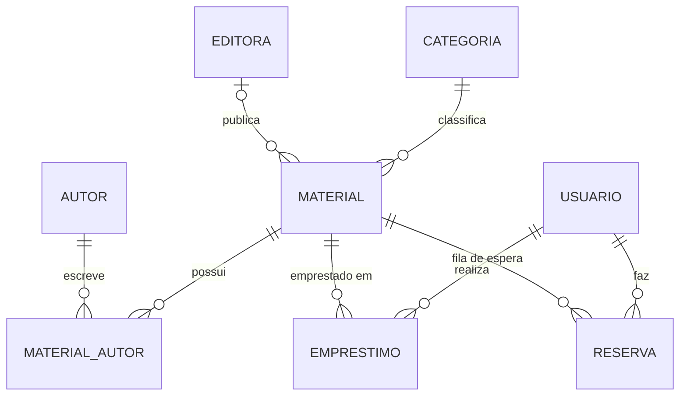

# Requisitos e modelagem

Versão em Markdown do planejamento. Fonte: [NP2 – Biblioteca Virtual Planejamento Completo.pdf](NP2%20%E2%80%93%20Biblioteca%20Virtual%20Planejamento%20Completo.pdf).

A NP2 é o backend (API REST) de uma biblioteca pública virtual para uma escola de ensino
médio, feito em equipe de 3 pessoas, com entrega e apresentação até 06/11/2026. Não há
interface visual.

## O que o professor exige

- 5 CRUDs completos (cadastrar, editar, listar, consultar por ID, excluir); o CRUD de usuário das aulas não conta
- Pelo menos 1 funcionalidade extra, alinhada com o professor
- Entidades com 4+ atributos além do ID e relacionamentos coerentes
- Camadas Model, DTO, Repository, Service e Controller
- Persistência em banco com migrations
- Validação de dados e tratamento de erros com códigos HTTP adequados
- Todas as rotas documentadas no Swagger
- GitHub com instruções de execução e contribuições de todos
- Uso de IA permitido, mas precisa ser registrado (ferramenta, uso e verificação)

### Avaliação (10 pontos)

| Bloco | Critério | Pontos |
|---|---|---|
| Sistema (equipe) | Funcionamento dos 5 CRUDs | 1,0 |
| Sistema (equipe) | Funcionalidade extra | 1,0 |
| Sistema (equipe) | Modelagem e camadas | 0,5 |
| Sistema (equipe) | Persistência e migrations | 0,5 |
| Sistema (equipe) | Validações e erros | 0,5 |
| Sistema (equipe) | Swagger e instruções | 0,5 |
| Apresentação (individual) | Clareza sobre a própria participação | 1,0 |
| Apresentação (individual) | Compreensão do código e decisões | 1,0 |
| Apresentação (individual) | Respostas às perguntas | 1,0 |
| GitHub (individual) | Contribuições relevantes | 1,0 |
| GitHub (individual) | Participação ao longo do projeto | 1,0 |
| GitHub (individual) | Commits identificáveis e descritivos | 1,0 |

A apresentação tem até 15 minutos: 10 de demo e 5 de perguntas individuais, sem IA e sem
responder pelo colega.

## Stack

| Requisito | Ferramenta |
|---|---|
| Linguagem / framework | Java com Spring Boot |
| Repository | Spring Data JPA |
| Migrations | Flyway |
| Validação | Bean Validation (`@Valid`, `@NotBlank` etc.) |
| Tratamento de erros | `@RestControllerAdvice` (`GlobalExceptionHandler`) |
| Swagger | springdoc-openapi |
| Tarefas agendadas | `@Scheduled` (status de atraso) |

## Decisões já tomadas

- **Banco de dados:** MySQL 8.4, rodando via Docker (`docker-compose.yml`). No PDF estava
  "a definir (PostgreSQL, MySQL ou H2)".
- **Schema:** criado e alterado só por migrations do Flyway; o Hibernate roda com
  `ddl-auto=validate` (apenas confere se as entidades batem com o banco).
- **Categoria:** `serieRecomendada` é obrigatória, porque no planejamento os campos
  opcionais estão marcados explicitamente como "opcional" e este não está.
- **Material:** pelo mesmo critério, `anoPublicacao` e `quantidadeLicencas` são obrigatórios
  (`NOT NULL`). A tabela foi criada na `V21` só com a ligação a Categoria; `editora_id` e a
  tabela `material_autor` entram numa `V22`, quando as tabelas `editoras` e `autores`
  (Pessoa 1) existirem.

**Em aberto:**
- Valor de RN02 (prazo padrão de empréstimo; sugestão: 14 dias)
- Valor de RN04 (máximo de empréstimos ativos por usuário; sugestão: 3)
- Dias dos acompanhamentos semanais com o professor

## Entidades

Os 5 CRUDs são **Material, Autor, Editora, Categoria e Emprestimo** (opção B, biblioteca
clássica). A funcionalidade extra adiciona a entidade **Reserva**, e o **Usuário** das aulas
é reaproveitado sem contar como CRUD.

### Nomes e convenções

| Classe Java | Tabela | Rota |
|---|---|---|
| `Material` | `materiais` | `/materiais` |
| `Autor` | `autores` | `/autores` |
| `Editora` | `editoras` | `/editoras` |
| `Categoria` | `categorias` | `/categorias` |
| `Emprestimo` | `emprestimos` | `/emprestimos` |
| `Reserva` | `reservas` | `/reservas` |
| (ligação N:N) | `material_autor` | — |

- Classes no singular, PascalCase e sem acento
- Tabelas no plural e em snake_case (`@Table`)
- Atributos em camelCase no Java e snake_case no banco
- DTOs no padrão `MaterialRequestDTO` / `MaterialResponseDTO`

**Por que Material e não Livro:** o enunciado fala em livros e outros materiais digitais. O
atributo `tipo` (`LIVRO`, `APOSTILA`, `ARTIGO`, `VIDEO`) cobre todo o acervo num único CRUD;
campos que não servem para todos os tipos ficam opcionais.

### Material

| Atributo | Tipo | Validação |
|---|---|---|
| titulo | String | obrigatório, até 200 caracteres |
| tipo | Enum | obrigatório |
| anoPublicacao | Integer | entre 1500 e o ano atual |
| sinopse | String (TEXT) | opcional |
| urlArquivo | String | obrigatório, URL válida |
| numeroPaginas | Integer | opcional, positivo |
| quantidadeLicencas | Integer | mínimo 1 |
| editora | FK → Editora | opcional (N:1) |
| categoria | FK → Categoria | obrigatório (N:1) |
| autores | Lista de Autor | N:N |

### Autor

| Atributo | Tipo | Validação |
|---|---|---|
| nome | String | obrigatório |
| nacionalidade | String | opcional |
| dataNascimento | LocalDate | no passado |
| biografia | String (TEXT) | opcional |

### Editora

| Atributo | Tipo | Validação |
|---|---|---|
| nome | String | obrigatório |
| cnpj | String | obrigatório, único, formato válido |
| cidade | String | obrigatório |
| site | String | URL válida |

### Categoria

| Atributo | Tipo | Validação |
|---|---|---|
| nome | String | obrigatório, único |
| descricao | String | opcional |
| areaConhecimento | String | obrigatório |
| serieRecomendada | Enum | `PRIMEIRO_ANO`, `SEGUNDO_ANO`, `TERCEIRO_ANO` |

### Emprestimo

| Atributo | Tipo | Validação |
|---|---|---|
| usuario | FK → Usuário | obrigatório (N:1) |
| material | FK → Material | obrigatório (N:1) |
| dataRetirada | LocalDateTime | gerada automaticamente |
| dataPrevistaDevolucao | LocalDate | após a retirada |
| dataDevolucao | LocalDateTime | preenchida ao devolver |
| status | Enum | `ATIVO`, `DEVOLVIDO`, `ATRASADO` |

### Reserva (funcionalidade extra)

| Atributo | Tipo | Validação |
|---|---|---|
| usuario | FK → Usuário | obrigatório |
| material | FK → Material | obrigatório |
| dataSolicitacao | LocalDateTime | automática, define a ordem da fila |
| status | Enum | `AGUARDANDO`, `ATENDIDA`, `CANCELADA` |
| dataAtendimento | LocalDateTime | preenchida ao virar empréstimo |

**Unicidade:** CNPJ da editora e nome da categoria são únicos para evitar registros
duplicados que dividiriam os materiais. A regra fica no banco (constraint `UNIQUE`) e no
Service (`existsBy...`, resposta 409).

### Relacionamentos

- Categoria 1:N Material (todo material tem uma categoria)
- Editora 1:N Material (opcional: um material pode não ter editora)
- Material N:N Autor, pela tabela `material_autor`
- Usuário 1:N Empréstimo e Material 1:N Empréstimo
- Usuário 1:N Reserva e Material 1:N Reserva

## Requisitos funcionais

| Código | Descrição |
|---|---|
| RF01 | Cadastrar, editar, listar, consultar por ID e excluir materiais |
| RF02 | Associar um material a um ou mais autores, a uma categoria e, opcionalmente, a uma editora |
| RF03 | Cadastrar, editar, listar, consultar por ID e excluir autores |
| RF04 | Cadastrar, editar, listar, consultar por ID e excluir editoras |
| RF05 | Cadastrar, editar, listar, consultar por ID e excluir categorias |
| RF06 | Registrar, editar, listar, consultar por ID e excluir empréstimos |
| RF07 | Registrar a devolução de um material emprestado |
| RF08 | Entrar na fila de espera de um material sem licenças disponíveis |
| RF09 | Atender automaticamente o primeiro da fila quando uma licença for liberada |
| RF10 | Consultar a fila de um material e as reservas de um usuário |
| RF11 | Cancelar uma reserva |

## Regras de negócio

| Código | Descrição |
|---|---|
| RN01 | Um material só pode ser emprestado se houver licenças disponíveis |
| RN02 | O prazo padrão de empréstimo é de X dias (sugestão: 14) |
| RN03 | Um usuário não pode ter o mesmo material emprestado duas vezes ao mesmo tempo |
| RN04 | Um usuário pode ter no máximo X empréstimos ativos (sugestão: 3) |
| RN05 | Empréstimos não devolvidos após o prazo passam ao status ATRASADO |
| RN06 | Não é permitido excluir autor, editora ou categoria vinculados a materiais |
| RN07 | O CNPJ da editora e o nome da categoria devem ser únicos |
| RN08 | Só é possível reservar um material sem licenças disponíveis |
| RN09 | Um usuário não pode estar duas vezes na mesma fila nem reservar algo que já tem emprestado |
| RN10 | A fila é atendida por ordem de solicitação |
| RN11 | Ao atender a reserva valem as regras de empréstimo; se o usuário não puder receber, passa para o próximo |

## Requisitos não funcionais

| Código | Descrição |
|---|---|
| RNF01 | Desenvolvido em Java com Spring Boot |
| RNF02 | Arquitetura em camadas: Model, DTO, Repository, Service e Controller |
| RNF03 | Persistência em banco relacional (definido: MySQL 8.4) |
| RNF04 | Criação e alteração de tabelas exclusivamente via migrations (Flyway) |
| RNF05 | Validação de entrada com mensagens claras e códigos HTTP adequados (400, 404, 409, 422) |
| RNF06 | Todas as rotas documentadas no Swagger |
| RNF07 | Código versionado no GitHub com instruções de execução no README |

## Funcionalidade extra: fila de espera

Quando todas as licenças de um material estão em uso, o aluno entra numa fila; quando
alguém devolve, o primeiro da fila recebe o empréstimo automaticamente. Foi escolhida no
lugar da recomendação personalizada por ter mais regra de negócio e dar sentido ao
atributo `quantidadeLicencas`.

### Fluxo

1. O aluno tenta pegar emprestado um material sem licença livre e recebe 409: "Sem
   licenças disponíveis. Entre na fila de espera."
2. Ele cria a reserva e entra no fim da fila.
3. Na devolução, o sistema pega a reserva AGUARDANDO mais antiga, cria o empréstimo para
   esse aluno e marca a reserva como ATENDIDA.
4. Sem ninguém na fila, a licença fica livre.

A posição na fila **não é salva no banco**: é calculada ordenando as reservas AGUARDANDO por
`dataSolicitacao`, o que evita reordenar a fila a cada cancelamento.

### Rotas

| Método | Rota | Ação |
|---|---|---|
| POST | `/materiais/{id}/reservas` | Entrar na fila |
| GET | `/materiais/{id}/fila` | Ver a fila do material com posições |
| GET | `/usuarios/{id}/reservas` | Ver as reservas e posições do aluno |
| PATCH | `/reservas/{id}/cancelar` | Sair da fila |

**Demo:** cadastrar um material com `quantidadeLicencas = 1` e usar 2 ou 3 usuários para
mostrar o ciclo completo no Swagger.

**Plano B:** se o professor achar a fila pesada demais, a alternativa é a recomendação
personalizada (`GET /usuarios/{id}/recomendacoes`, baseada nas categorias e autores mais
emprestados pelo aluno).
